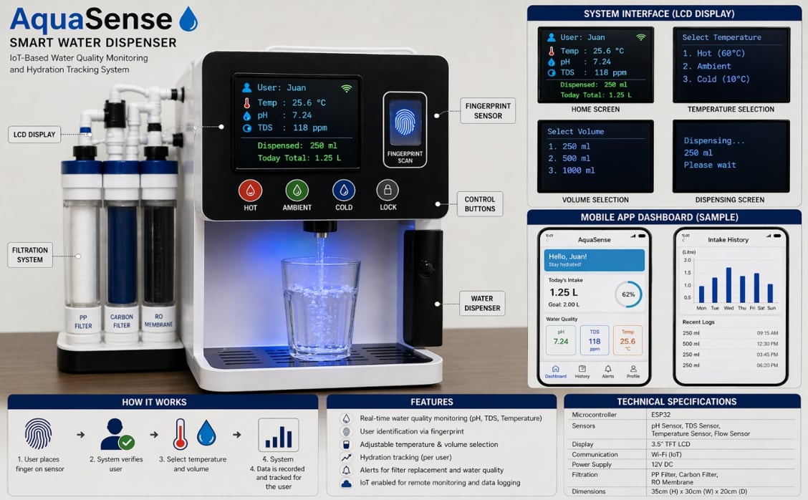

### 💧 Smart Water Dispensing System

**Embedded Systems · Internet of Things · Automation**

*Smarter Dispensing. Better Monitoring. Informed Hydration.* ♡

🌸 Welcome to our AquaSense project repository! 🌸

---

## 🎀 Table of Contents

- [About the Project](#-about-the-project)
- [Project Objectives](#-project-objectives)
- [Project Prototype](#-project-prototype)
- [Key Features](#-key-features)
- [Hardware Components](#-hardware-components)
- [Software and Technologies](#-software-and-technologies)
- [System Workflow](#-system-workflow)
- [Project Significance](#-project-significance)
- [Future Enhancements](#-future-enhancements)
- [Safety Disclaimer](#-safety-disclaimer)
- [Project Information](#-project-information)

---

## 🌷 About the Project

**AquaSense – Smart Water Dispensing System** is an embedded systems and Internet of Things (IoT) project designed to support water dispensing, water parameter monitoring, user identification, and hydration awareness.

The system uses an **ESP32 microcontroller** to integrate sensor readings, fingerprint-based authentication, automated water dispensing, and an LCD interface.

AquaSense aims to demonstrate how computer engineering, embedded systems, and IoT technologies can be applied to everyday water consumption and monitoring.

## 💗 Project Objectives

- 💧 Monitor selected water parameters in real time.
- 🔐 Identify registered users through fingerprint recognition.
- 🚰 Automate water dispensing using a pump or solenoid valve.
- 📊 Estimate the volume of water dispensed.
- 🌸 Track individual water consumption and hydration progress.
- 📟 Display sensor readings and system information.
- 📡 Establish a foundation for future IoT monitoring and reporting.

## 📸 Project Prototype

**Figure 1. AquaSense Smart Water Dispensing System Prototype**

*Our embedded systems and IoT project in development. ♡*

> **Important:** Upload your actual prototype photo to the repository using the filename `aquasense-prototype.jpg`. The image will appear here once the file has been uploaded successfully.

## ✨ Key Features

### 💧 1. Water Quality Monitoring

Monitors selected water parameters using appropriate sensors, including total dissolved solids (TDS) and water temperature.

### 🔐 2. Fingerprint Authentication

Uses a fingerprint sensor to identify registered users before allowing authorized water dispensing.

### 🚰 3. Automated Water Dispensing

Controls a water pump or solenoid valve through the ESP32 to manage water dispensing.

### 📊 4. Personalized Hydration Tracking

Estimates the amount of water dispensed to each recognized user and supports tracking against a configurable hydration goal.

### 📟 5. Real-Time Information Display

Displays sensor readings, authentication status, and dispensing information through an LCD.

### 📡 6. IoT Integration

Provides a foundation for future Wi-Fi connectivity, remote monitoring, and a web-based dashboard.

## 🛠️ Hardware Components

| Component | Purpose |
|---|---|
| ESP32 Development Board | Main controller and Wi-Fi connectivity |
| Fingerprint Sensor Module | User authentication |
| TDS Sensor Module | Estimates total dissolved solids |
| DS18B20 Temperature Sensor | Measures water temperature |
| Water Flow Sensor | Estimates dispensed water volume |
| 16×2 I2C LCD | Displays system information |
| Relay Module / Motor Driver | Controls the dispensing mechanism |
| Water Pump / Solenoid Valve | Controls water flow |
| Regulated Power Supply | Supplies appropriate electrical power |
| Jumper Wires and Tubing | Electrical connections and water delivery |

## 💻 Software and Technologies

- Arduino IDE
- ESP32 microcontroller platform
- Embedded C/C++
- Sensor integration and data processing
- Fingerprint recognition
- Internet of Things (IoT)
- Wi-Fi connectivity for future development

## 🔄 System Workflow

1. **System Initialization** — The ESP32 initializes the sensors and LCD.
2. **Water Monitoring** — The system reads the available water sensor measurements.
3. **User Authentication** — The user scans a registered fingerprint.
4. **Condition Verification** — The controller checks the configured dispensing conditions.
5. **Automatic Dispensing** — The pump or solenoid valve activates when the conditions are satisfied.
6. **Volume Measurement** — The flow sensor estimates the amount of water dispensed.
7. **Consumption Tracking** — The system records the estimated consumption of the recognized user.
8. **Status Display** — The LCD displays current readings and system status.

## 🌸 Project Significance

AquaSense demonstrates the practical application of embedded systems, automation, sensor integration, and IoT technologies.

By combining fingerprint authentication, water parameter monitoring, and automated dispensing, the project aims to improve dispensing convenience and promote awareness of individual water consumption.

The prototype also provides opportunities to explore connected devices, data processing, and future smart monitoring applications.

## 🚀 Future Enhancements

- [ ] 🌐 Web-based IoT dashboard
- [ ] 📱 Mobile application integration
- [ ] ☁️ Cloud-based data storage
- [ ] 📅 Persistent daily hydration records
- [ ] 🎯 Personalized hydration goals
- [ ] 🪣 Water reservoir level monitoring
- [ ] ⚠️ Leak detection and system alerts
- [ ] 💧 Enhanced water quality monitoring
- [ ] 📈 Consumption history and graphical reports

## ⚠️ Safety Disclaimer

AquaSense is an educational prototype and is **not a certified water purification or drinking-water safety device**.

TDS and temperature readings alone cannot establish whether water is safe to drink. Real-world use requires appropriate sensor calibration, sanitary system design, and independent water quality testing.

## 📌 Project Information

| Detail | Description |
|---|---|
| Project Name | AquaSense – Smart Water Dispensing System |
| Project Category | Embedded Systems and IoT |
| Main Controller | ESP32 |
| Primary Purpose | Smart dispensing, sensor monitoring, fingerprint authentication, and hydration tracking |
| Development Stage | Prototype / In Development |
| Development Environment | Arduino IDE |
| Programming Language | Embedded C/C++ |

## 💌 Project Team

This project is part of our exploration of computer engineering, embedded systems, and Internet of Things technologies.

We aim to develop a functional prototype that demonstrates the integration of hardware, sensors, and automated control.

---

### 💗 Thank You for Visiting AquaSense!

*Keep learning. Keep creating. Keep growing. ♡*

